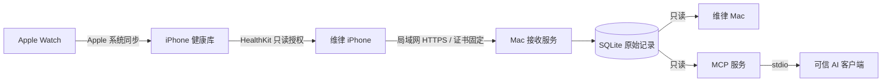

<p align="center">
  
</p>

# 维律 Veyra

**你的身体，自有脉络。**

[](https://github.com/zxycode7/watch-health/actions/workflows/ci.yml)

个人健康数据空间：**自己的 iPhone App → 自己的 Mac → 本地只读 MCP**。

维律通过本人授权读取 Apple 健康记录，在局域网内加密同步到自己的 Mac，并提供原生桌面浏览和 AI 查询入口。Apple Watch 的记录先由 Apple 系统同步到 iPhone，当前版本无需额外安装手表 App。

当前版本 **0.2.0**。包含 iPhone 和 Mac 原生客户端、HTTPS 接收服务、SQLite 数据库与只读 stdio MCP；不依赖第三方导出 App、托管健康数据平台、API 密钥或运行时第三方库。

## 功能

| 部分 | 当前能力 |
| --- | --- |
| iPhone | 概览 / 数据 / 设置；28 类指标选择；最近样本曲线、来源和设备版本；补录历史、保存进度后停止同步；浅色 / 深色 / 跟随系统 |
| Mac | 数据目录、原始记录表格和采样图；按指标、来源、时间筛选；100 条分页；设备与配对二维码；存储及服务控制 |
| MCP | 实际检测初始化、工具列表和数据状态；展示本机配置；提供三个只读查询工具 |
| 同步 | HealthKit anchor 增量读取、删除传播、UUID 去重；Mac 完整确认后才保存手机进度 |
| 连接 | 五分钟一次性配对、HTTPS 证书固定校验、iOS Keychain 凭据、Mac 令牌哈希 |
| 升级 | 代码变化时备份旧运行目录和一致性数据库快照，保留配对、证书与已有客户端配置 |

原始记录保留 UUID、起止时间、单位、来源和设备信息。**条数不是健康评分，空记录不是零活动**；不跨来源直接累加步数，也不混合累加卧床与不同睡眠阶段。

## 数据如何流动



Mac 客户端负责浏览和控制，接收服务通过用户 LaunchAgent 独立运行。退出客户端不会停止接收；停止接收后，已有记录仍可在客户端和 MCP 中查询。

## 支持的 28 类指标

| 分组 | 数量 | 指标 |
| --- | ---: | --- |
| 心脏 | 6 | 心率、静息心率、心率变异性 SDNN、最大摄氧量、心率恢复、步行平均心率 |
| 呼吸与睡眠 | 5 | 血氧、呼吸频率、睡眠手腕温度、睡眠阶段、睡眠呼吸紊乱 |
| 活动 | 8 | 步数、活动能量、锻炼时间、体能训练、静息能量、步行与跑步距离、爬楼层数、站立时间 |
| 步态 | 5 | 步行速度、步长、步行不对称性、双足支撑时间、步行稳定性 |
| 身体 | 1 | 体重 |
| 环境 | 3 | 日照时间、环境音量、耳机音量 |

首次默认选择步数、心率、静息心率、HRV、睡眠、体能训练和活动能量；其余项目由本人选择后再确认健康读取权限。首次同步最近 30 天，可补录 90 天、一年或全部历史。

目录表示已经接入的读取类型，不保证每台设备都有记录。实际可读性取决于表款、系统、地区功能、已有样本及本人授权；睡眠呼吸紊乱需要 iOS 18+ 的对应接口。HealthKit 不披露具体哪些读取权限被拒绝，不能仅凭空结果作判断。

协议键和单位见 [原生指标目录](ios/WatchBridge/Models.swift) 与 [接收端目录](watchbridge/store.py)，一致性由自动化测试检查。百分数按 0–100 表示，并附带单位约定元数据。

## 快速开始

### 环境要求

| 用途 | 要求 |
| --- | --- |
| iPhone App | iOS 17+，支持 Apple 健康的实体 iPhone |
| Mac 客户端 | macOS 14+ |
| 接收与 MCP 服务 | Python 3.11+，无需 pip 或 npm 安装 |
| 从源码构建 | 完整 Xcode，包含 iOS 18 或更新 SDK；构建机须满足所选 Xcode 的系统要求 |
| AI 查询 | 支持 stdio MCP 的客户端；安装器提供 Codex 配置入口 |

App 当前通过源码构建和本地签名安装，尚未上架 App Store。Mac 构建脚本生成本机 ad-hoc 签名应用；iPhone 需要自己的开发 Team，并在签名到期前重新构建安装。

### 1. 获取源码，启动 Mac 客户端

```sh
git clone https://github.com/zxycode7/watch-health.git
cd watch-health
python3 scripts/build_mac.py
open build/Veyra.app
```

可将 `build/Veyra.app` 移到自己的 Applications 目录。在客户端「存储与服务」点击「安装 / 更新本机服务」，完成接收服务与 MCP 配置。

也可以直接安装服务：

```sh
python3 scripts/install_mac.py
```

安装器将运行文件复制到 `~/Library/Application Support/WatchBridge/runtime/`，建立私有数据库和 TLS 证书，注册用户登录后自动启动的 LaunchAgent，并新增 `watchbridge` MCP 配置。原有配置先备份；不同的同名配置或其他来源的运行目录不会被直接覆盖。

### 2. 安装 iPhone App

```sh
open ios/WatchBridge.xcodeproj
```

1. 在 Signing & Capabilities 选择自己的开发 Team，保留 HealthKit 与 HealthKit Background Delivery 能力。
2. 连接、解锁并信任自己的 iPhone，按系统提示开启开发者模式。
3. 选择实体 iPhone，构建并运行；按系统提示完成开发者 App 信任。
4. 如需修改 Bundle ID，使用自己的唯一标识；已有安装升级时保持原 Bundle ID 与 Team，避免影响数据和配对。

具体签名能力和有效期以自己的 Team 实际生成的描述文件为准。项目不包含个人签名凭据，模拟器不能替代真机健康数据验收。

### 3. 配对并首次同步

在 Mac 客户端「设备与配对」生成二维码。手机与 Mac 连接同一 Wi‑Fi，用 iPhone 系统相机扫码，在维律中核对目标 Mac 并点「确认配对」。

CLI 也可生成本地二维码：

```sh
python3 scripts/pair.py
```

配对链接五分钟有效，只能使用一次；二维码在本机生成，不上传到网站。需要粘贴链接或指定网卡地址时：

```sh
python3 scripts/run.py pair
python3 scripts/run.py pair --endpoint https://你的局域网IP:8765
```

配对后选择数据，点击「授权并同步」，确认系统健康读取与本地网络权限。部分系统版本先选择主题并点「继续」，再选择历史范围并点「允许」。首次同步保持手机解锁、App 打开；若 Mac 防火墙询问 Python 传入连接，需要允许本地网络连接。

## MCP 查询

在 Mac「MCP 控制台」检测连接、查看工具并复制本机配置。安装器注册后，在 Codex 中重新加载 MCP 或重开聊天使用：

| 工具 | 用途 |
| --- | --- |
| `watchbridge_status` | 指标、记录数量、可用时间范围和设备同步状态 |
| `watchbridge_day` | 按本地日历日读取某项原始记录，默认北京时间 |
| `watchbridge_records` | 按指标、起止时间及可选来源分页读取 |

例如可以问：「检查维律连接」「查看昨天来自 Apple Watch 的心率记录」。调用参数示例：

```json
{
  "name": "watchbridge_day",
  "arguments": {
    "type": "heart_rate",
    "date": "2026-10-16",
    "timezone": "Asia/Shanghai",
    "limit": 100
  }
}
```

每页最多 500 条，`next_offset` 表示下一页位置。范围查询使用带时区的时间戳，含起点、不含终点，并保留与窗口重叠的睡眠等区间。精确来源筛选使用记录中的 `source_bundle`，不能按显示名称推断。

本项目不提供任意 SQL、文件读取或修改数据的 MCP 工具。**AI 查询结果会进入当前对话和所用模型服务**；本地存储不等于查询内容永不离开 Mac，请只向可信客户端开放。

## 升级、停止与备份

升级已有服务：

```sh
git pull
python3 scripts/install_mac.py --upgrade
```

检测到代码变化时，安装器先在私有状态目录的 `backups/` 中保存旧运行文件和一致性 SQLite 快照，再切换代码并重启服务；配对、证书与客户端配置保留。Mac 客户端和 iPhone App 的界面更新仍需重新构建安装。

- 手机「暂停同步」：停止后续同步，保留已有记录。
- 手机「停止本次同步」：在已确认页的边界停止，保留已保存的进度。
- Mac「停止接收服务」：暂时不能接收上传，已有数据及只读查询保留。
- 撤销设备：立即阻止该设备后续上传，已有记录保留。

```sh
python3 scripts/run.py status
python3 scripts/run.py revoke 设备UUID
```

替换 Mac 后，旧 Mac 上的令牌需在旧 Mac 撤销。手动停止 LaunchAgent：

```sh
launchctl bootout "gui/$(id -u)/local.watchbridge.sync"
```

彻底停用时移除 `~/Library/LaunchAgents/local.watchbridge.sync.plist`，并用 `codex mcp remove watchbridge` 移除查询入口。是否保留数据库由本人决定，项目不会自动清库。

手动备份前先停止服务，再复制完整的 `~/Library/Application Support/WatchBridge/`，包括数据库及其 WAL 文件、证书和私钥。备份同样包含个人健康数据，需妥善保管。

## 常见问题与数据边界

| 情况 | 检查或恢复方式 |
| --- | --- |
| 「确认配对」不可点击 | 查看输入框下方提示，确认收到完整有效链接 |
| 链接过期或已使用 | 在 Mac 重新生成二维码或链接 |
| 连接不到 Mac | 检查同一 Wi‑Fi、本地网络权限、服务状态与防火墙；首次允许权限后可重试，Mac 地址变化时需更新配对 |
| 某项没有数据 | 检查健康 App 已有记录、所选项目及授权；也可能受表款、系统或地区支持限制 |
| 后台同步延后 | iOS 决定运行时机；锁屏、低电量、强退、Mac 休眠或网络变化均可能影响，打开 App 可继续补齐 |

手机数据页展示本机最近样本，Mac 客户端展示已入库记录；两者不是同一个实时视图。图表保留来源，不生成未经定义的健康、压力或恢复评分。

## 更底层数据探索

| 方向 | 已核实的路径 | 当前实现 |
| --- | --- | --- |
| 既有 ECG 电压波形 | HealthKit ECG 查询 | 尚未接入 |
| 逐搏心跳序列 / RR | HealthKit 心跳序列查询，需保留缺口语义 | 尚未接入 |
| 高频运动传感数据 | 独立 watchOS App 主动采集，需支持性和耗电验证 | 尚未开发手表端 |
| 原始 PPG | SensorKit，需 Apple 批准的研究项目及专门 entitlement | 当前未获对应权限 |

硬件存在不等于系统已保存数据，也不等于普通第三方 App 已获读取入口。完整依据、地区功能更新、GitHub 参考项目及开发顺序见 [Apple Watch 数据可行性与实施路径](docs/APPLE-WATCH-DATA-RESEARCH.md)。

## 开发与验证

在仓库根目录运行相关检查：

```sh
python3 -m unittest discover -s tests -v
python3 -m tests.test_swift_transport
swift test
xcrun swiftc -frontend -parse ios/WatchBridge/*.swift
xcodebuild -project ios/WatchBridge.xcodeproj -scheme WatchBridge -destination 'generic/platform=iOS Simulator' -derivedDataPath build/DerivedData CODE_SIGNING_ALLOWED=NO build
```

截至 2026-10-17 的本地验证快照：15 项 Python 测试、4 项 Mac 测试通过；完成真实 TLS 配对、证书与鉴权失败路径、真机导航和增量同步、Mac 原生界面操作及签名检查。自动化单元与传输测试使用临时合成数据；真机 UI 检查读取本人已授权记录。详细范围见 [BUILD-STATUS.json](BUILD-STATUS.json)。

真机 UI 检查需先安装当前 App、完成配对与授权，再显式指定自己的设备和 Team：

```sh
python3 scripts/test_iphone.py --device YOUR_DEVICE_ID --team YOUR_TEAM_ID
```

该检查覆盖三页导航、原始记录详情、能力说明与增量同步，不自动切换健康权限或注入配对信息。结果含个人界面，默认保存在忽略提交的 `build/DeviceChecks/`。

CI 覆盖 Python 测试、Swift/TLS 传输、共享组件类型检查、iOS 模拟器构建及 Mac 构建与测试，以 [GitHub Actions](https://github.com/zxycode7/watch-health/actions) 实际结果为准。**长期后台 / 锁屏稳定性、完整 VoiceOver 与辅助功能大字矩阵仍待验收。**

## 项目结构

| 路径 | 内容 |
| --- | --- |
| `ios/` | Xcode 工程、SwiftUI、HealthKit、Keychain、HTTPS 客户端及两端共享指标和主题 |
| `macos/` | SwiftUI / Charts / 只读 SQLite 客户端与回归测试 |
| `watchbridge/` | Python HTTPS 接收、SQLite、CLI 和只读 MCP |
| `scripts/` | 服务安装升级、Mac 打包、本地二维码与真机检查 |
| `tests/` | 存储、鉴权、删除、时区、分页、MCP、安装升级、目录一致性及原生传输测试 |
| `assets/brand/` | 原创图标母版、生成方式和提示词 |
| `docs/` | 底层数据可行性与实施路径 |

协作约定见 [AGENTS.md](AGENTS.md)，数据与权限约束见 [PRODUCT.md](PRODUCT.md)，视觉及交互约束见 [DESIGN.md](DESIGN.md)、[UX-CONTRACT.md](UX-CONTRACT.md)。

品牌已更名为维律 Veyra，底层仍保留 `WatchBridge` / `watchbridge` 的 Bundle ID、Keychain、URL scheme、数据目录、LaunchAgent 和 MCP 标识，以兼容原有安装。个人健康记录、配对二维码、设备日志和签名材料不随源码发布。
